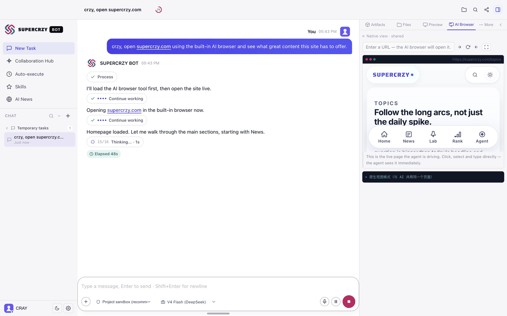
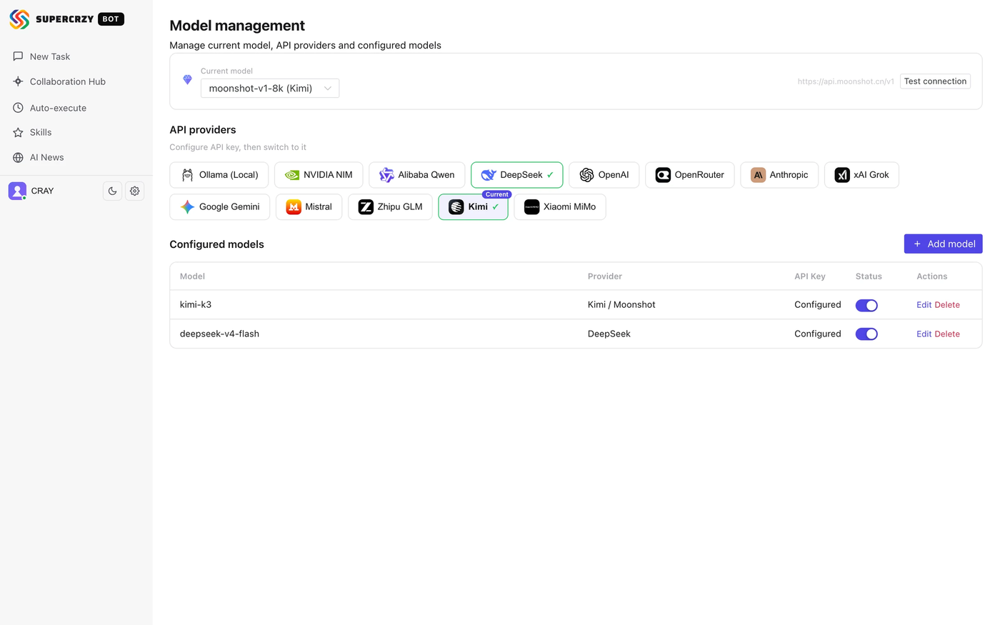

<p align="center">
  
</p>

# SUPERCRZY BOT

<p align="center">
  <a href="https://supercrzy.com/bot"></a>
  <a href="https://github.com/SuperCrzy/Supercrzy-Bot/releases/latest"></a>
  <a href="https://github.com/SuperCrzy/Supercrzy-Bot/blob/main/LICENSE"></a>
  <a href="README.zh-CN.md"></a>
</p>

A ready-to-run **AI Agent platform** — unified brain + Agent Loop + multi-tool + multi-platform gateway, natively wired to DeepSeek V4 with support for 200+ models via OpenAI-compatible providers.

**Bring your own key, keep every session on your own disk.** No subscription, no inference markup, no account — the app talks to the provider you already pay, and the whole stack is MIT-licensed.

Three things most self-hosted agents don't ship together: a **full web UI** (15 screens, not a terminal), **cross-vendor review** where one model doesn't grade its own work, and a **content feed that needs no API key**.

<p align="center">
  
</p>

<p align="center">
  <em>Screen recording from the app — a real session, no mockups.</em>
</p>

<p align="center">
  
  
</p>

## Quick Install

**macOS (Apple Silicon)** — [download the .dmg](https://github.com/SuperCrzy/Supercrzy-Bot/releases/latest), open it, drag the app to Applications. First launch: right-click → Open (the build is unsigned).

**Windows (x64)** — [download the .exe setup](https://github.com/SuperCrzy/Supercrzy-Bot/releases/latest), run it. The installer is unsigned, so SmartScreen will ask you to allow it once.

**From source** — macOS, Linux or WSL2 (needs Node 22.x + pnpm 10.x):

```bash
git clone https://github.com/SuperCrzy/Supercrzy-Bot.git
cd Supercrzy-Bot
./start.sh          # first run installs deps + builds (3-8 min), then starts and opens your browser
```

> `start.sh` needs no setup: it verifies Node and pnpm, creates `.env` if missing, builds the frontend and opens the app. Stop it with `./start.sh stop`.
> Want a `supercrzy` command that works from any directory? `npm link` afterwards.

Then [add your model key](#-model-providers) in the app — DeepSeek, OpenRouter, OpenAI, Anthropic, Gemini, xAI, Mistral, Qwen or a local Ollama.

## ✨ Highlights

**It does the work, and shows you the work.** The three things below that rivals rarely ship together are marked with ★.

- **Agent Loop** — multi-turn reasoning plus 44 tools: files, shell, web, memory, skills. Every step renders live in a timeline you can replay, branch and resume from a checkpoint.
- ★ **A full web UI, not a terminal** — 15 screens: chat with a live execution timeline, workspace with editor and file browser, models, memory, skills, gateway, logs, usage. The same server also serves a CLI, so the UI is a choice rather than a requirement.
- **A real terminal, not a one-shot shell** — six terminal tools that keep a session alive: start a dev server in the background, run an interactive program, read output incrementally, send SIGINT. Distinct from `shell_exec`, which is fire-and-forget.
- **It builds things you can see** — `draw_diagram` emits SVG that renders inline in the conversation; `generate_image` produces images; `make_article` takes a URL or a YouTube link and returns a finished illustrated write-up; `video_edit` trims and concatenates media.
- ★ **Research with sources** — `deep_research` recurses through searches, widens depth, and returns a multi-page report with a Sources list. `news_search` reads this project's own RSS feed, no API key, no rate limit.
- **Plans you can watch, and that self-check** — `create_plan` lays out steps before acting, the UI tracks them as a plan card, and `get_goal` lets the agent notice mid-run that it has drifted from what you asked.
- **It knows when the code it just wrote is broken** — `lint_file` runs a static pass after a write: dangerous patterns, leaked credentials, unbalanced brackets.
- ★ **One model does not grade its own homework** — the Collaboration Hub runs execution, quality review and audit on different vendors' models (DeepSeek executes, Kimi reviews, GPT joins the senate). Stage progress persists to SQLite, so a run survives a restart.
- **Playbook** — after a task, a retrospective is written down; a similar next task gets those lessons injected before it starts.
- **Skills as a supply chain** — 32 built-in in a catalog, plus 461 browser-automation skills from browse.sh and the official repositories of OpenAI, Anthropic, Hugging Face and NVIDIA. Skills also write and patch themselves.
- **Long-term memory** — facts extracted across sessions, weighted when injected, deduplicated over time. Extraction runs through a serial worker so a busy day doesn't turn into a rate-limit incident.
- **Computer Use** — screenshot, click, type, key combos, scroll, launch apps. Screenshots come back as images, so the agent sees what its click did. Three gates: per-call confirmation, full-permission sessions only, and macOS Screen Recording + Accessibility.
- **Eight channels, one memory** — WeChat, WeCom, DingTalk, Feishu, QQ, Telegram, Discord, Slack all share the same sessions, skills and memory as the desktop app.
- **Secure by default** — sensitive tools require confirmation, dangerous commands are blocked by a command-level classifier, shell access is sandboxed in three layers, files are confined to a workspace whitelist.

## 🔧 Engineering Notes

These are the decisions that only show up when you run an agent on a real machine. Each item names the file it lives in.

**Shell access is sandboxed in three layers.** A command blacklist catches the extremes — root deletion, `sudo`, fork bombs, curl-pipe-to-shell. A second layer scans the command for dangerous paths in pure Node, so it holds in any environment. On macOS a third layer applies a kernel-level `sandbox-exec` profile, the SBPL equivalent of Linux Landlock, that permits the project repository and `/tmp` and denies **all** reads and writes under the user's home directory:

```
(deny file-read*  (subpath "$HOME"))
(deny file-write* (subpath "$HOME"))
(allow file-read* (subpath "$PROJECT_ROOT"))
```

Credential files inside the repository are denied by literal rule as a fallback, and where `sandbox-exec` is unavailable — CI, nested containers — the layer degrades instead of failing closed. *`services/sandbox.ts`*

**Streaming has back-pressure control and disconnect protection.** The naive `res.write(chunk)` fails in two ways that both look like "the backend is fine, the interface is frozen": it returns `false` when the socket buffer fills, so a slow client makes events pile up in server memory while the server reports perfect health; and writing after a disconnect throws, which — because the response is detached from Koa — becomes an uncaught exception that takes the whole backend down. Both are handled in one guarded write path, and the counters are exposed on the health endpoint, so "is it stuck?" has a number rather than a hunch. *`services/sse-health.ts`*

**Stalls are diagnosed with an objective measure, not by eye.** Two earlier investigations reached opposite conclusions about the same freeze because there was no metric to settle it. Event-loop delay is now sampled every second and reset each time, keeping a rolling 60-second window — because `perf_hooks.monitorEventLoopDelay` returns a *cumulative* histogram whose peaks flatten out over a long uptime. Normal lag plus a frozen client means the problem is in transport, and you stop digging in the backend. *`services/event-loop-lag.ts`*

**Skills write and repair themselves.** Complex tasks are distilled into standard `SKILL.md` files after completion, and a skill that was used but failed gets patched. The Playbook and the skill library are two different learning surfaces on purpose: one stores one-line lessons injected into prompts, the other stores reusable step workflows loaded on demand. *`services/skill-evolve.ts`*

**Memory extraction runs serially, by design.** A single background worker with a FIFO queue and a maximum concurrency of one. Firing an LLM extraction call on every turn of every session is how you get rate-limited and surprised by a bill; serializing them throttles naturally. Reads and writes form a loop — semantic pre-fetch before a turn, sync after it. *`services/memory-worker.ts`*

**Search is a plugin chain, not a ladder of conditionals.** `web_search` used to be five nested `if` blocks. It now walks a provider interface in priority order — Tavily, Serper, SearXNG, DeepSeek, Bing — and takes the first non-empty result. Adding an engine means implementing the interface and pushing it onto the array. *`services/search-providers.ts`*

**The content feed needs no API key.** News search reads `supercrzy.com/feed.xml` — plain RSS 2.0, live, no key, no cost, no rate limit. The agent consumes the project's own editorial output, which is the closed loop this product is built around. *`services/supercrzy-feed.ts`*

## 🌍 Model Providers

The Models page (`/models`) ships with 13 provider presets supporting the OpenAI-compatible protocol:

| Provider | Notes |
|------|------|
| **OpenRouter** (recommended) | **One key for 200+ models** — Claude, GPT, Gemini, Grok, Mistral and more. `https://openrouter.ai/api/v1` |
| **OpenAI** | GPT-4o etc. `https://api.openai.com/v1` |
| **xAI Grok** | Grok series. `https://api.x.ai/v1` |
| **Mistral** | Mistral series. `https://api.mistral.ai/v1` |
| **Meta Llama** | Llama series via Groq free tier. `https://api.groq.com/openai/v1` |
| **NVIDIA NIM** | NVIDIA official inference endpoints. `https://integrate.api.nvidia.com/v1` |
| **Alibaba Qwen** | Qwen official compatible endpoint. `https://dashscope.aliyuncs.com/compatible-mode/v1` |
| Anthropic / Gemini | Native APIs differ; use them through OpenRouter |

Usage: open the Models page → click a provider → paste your API key (baseUrl editable) → click "Discover models" to list models available for that key → pick one. Keys from multiple providers can coexist and you can switch anytime.

### Local models (Ollama)

A built-in **Ollama (local)** provider is included: install [Ollama](https://ollama.com), `ollama pull llama3.1`, then on the Models page pick Ollama → "Discover models" → the locally pulled models (`llama3.1:8b` etc.) are listed automatically. Leave the API key empty (no auth needed locally).

## 🚀 Installation Details

### Requirements (pinned)

| Item | Required | Why |
|---|---|---|
| **Node.js** | **22.x**（`>=22.18.0 <23`；见 `.nvmrc` = `22.22.2`） | Declared in `engines`. Other majors are unverified. |
| **pnpm** | **`>=10`**（`packageManager` = `pnpm@10.33.3`） | Repo is a pnpm workspace; npm/yarn will break the lockfile. Enable via `corepack enable`. |
| **Chrome / Chromium** | *optional* | Only needed by the `browser` tool and `computer_use` (Playwright drives your real Chrome). Everything else runs without it. |
| **OS** | macOS / Linux / Windows | Verified on macOS 15 (arm64). |

Quick check + install:

```bash
node -v    # should print v22.x
pnpm -v    # should print 10.x  (corepack enable  # if missing)
```

> Versions above are **pinned on purpose** — a mismatched Node/pnpm is the most common
> "install works but build/test fails" cause. Use `nvm use` (reads `.nvmrc`) to match.

### Option 1: terminal one-liner (first-time users)

```bash
git clone https://github.com/SuperCrzy/Supercrzy-Bot.git
cd Supercrzy-Bot
./start.sh          # checks env → installs deps → builds frontend → starts → opens browser
```

> `./start.sh` needs **no setup** — it verifies Node/pnpm, creates `.env` if missing,
> builds the frontend, starts the server and opens your browser. Stop it with `./start.sh stop`.

### Option 2: double-click launcher (no terminal)

> **macOS**:
> 1. Double-click **`scripts/install.command`** — it generates `SUPERCRZY BOT.app` and puts a
>    "SUPERCRZY BOT" icon on your Desktop
> 2. Double-click the desktop icon → the UI opens in your browser
> 3. Or, without installing anything, double-click **`SUPERCRZY BOT.command`** inside the project
> If blocked on first run: right-click → Open.
> (`SUPERCRZY BOT.app` is **generated**, not shipped — keep it at the project root, next to
> `start.sh`; re-run the installer after moving the project)
>
> **Windows**: double-click **`start.bat`** — the UI opens in your browser.
>
> **Linux**: run **`./scripts/install-linux.sh`** once — it writes a `.desktop` entry to your
> application menu and desktop. Then launch "SUPERCRZY BOT" like any other app.
>
> Linux/terminal: run `./start.sh`.

### Option 3 (optional): install as a global command

After cloning (any option above), make `supercrzy` available from **any directory**:

```bash
npm link                   # or: pnpm setup && pnpm link --global

supercrzy                  # start (same as ./start.sh)
supercrzy dev              # dev mode (server + client, 5173 hot reload)
supercrzy cli              # chat in the terminal
supercrzy stop             # stop the background server
supercrzy status           # show versions & server state
supercrzy install          # create a desktop launcher icon (macOS)
```

> A **convenience, not a requirement** — `./start.sh` already does everything.
> `supercrzy web` / `stop` / `install` forward to the very same `start.sh` / `install.command`,
> so behaviour is identical either way.

### Option 4: manual (development)

```bash
# 1. Install dependencies (Node 22.x + pnpm 10.x required — see Requirements above)
pnpm install

# 2. Configure (choose one)
cp .env.example .env        # edit .env, fill OPENAI_KEY=sk-...
# or skip this — after startup, configure your key in Web UI → Models (/models) page (recommended, no restart)

# 3. Start (production single process: http://localhost:3000)
pnpm --filter @supercrzy/server start
# or dev mode (hot reload): pnpm dev → http://localhost:5173
```

Open **http://localhost:3000** (one port serves both the page and the API — no extra frontend process):
- On first launch, the home page prompts you to **configure an API key**; click through to the Models page (`/models`)
- The database initializes automatically — no manual table setup

### Other commands

| Command | Description |
|------|------|
| `SUPERCRZY BOT.app` | double-click launch (macOS desktop app) — **generated** by the installer, not shipped |
| `SUPERCRZY BOT.command` | double-click launch (macOS terminal entry) |
| `start.bat` | double-click launch (Windows one-click script) |
| `./start.sh` | one-click start (production mode, opens browser) |
| `pnpm dev` | dev mode (hot reload, frontend 5173 + backend 3000) |
| `pnpm cli` | terminal chat mode (CLI-first!) |
| `pnpm build` | production build (outputs to client/dist, served statically by backend) |
| `pnpm test` | run all tests (server + client) |
| **`pnpm verify`** | **pre-push gate: lint + test + tool-registry check + build.** Run this before "it works on my machine". |
| `./scripts/install.command` | installer: creates a launch icon on the Desktop |
| `./scripts/make-app.sh` | regenerate the macOS desktop app (run after updating the logo) |

## 🎮 CLI Mode

```bash
pnpm cli
```
Chat with the agent directly in the terminal — streaming output and tool calls supported. Great for server/SSH environments.

## ⚙️ Environment Variables (.env)

| Variable | Description | Default |
|------|------|------|
| `PORT` | backend port | `3000` |
| `OPENAI_KEY` | provider API key (the variable the server actually reads) | - |
| `DEEPSEEK_API_KEY` | legacy alias — only honoured as a last-resort fallback by the search/tool layer | - |
| `DEEPSEEK_BASE_URL` | API base URL | `https://api.deepseek.com` |
| `DEEPSEEK_MODEL` | default model | `deepseek-v4-pro` |
| `CORS_ORIGINS` | CORS whitelist (comma-separated) | localhost only |
| `API_TOKEN` | optional Bearer token for non-local API requests | empty (disabled) |
| `TUNNEL_ENABLED` | enable tunneling (default off, fully local) | `false` |

## 🏗️ Architecture

```
Supercrzy-Bot/
├── packages/
│   ├── client/          # Vue3 + NaiveUI + Monaco frontend
│   │   └── src/views/   # chat / workspace / skills / memory / models / usage pages
│   └── server/          # Koa + better-sqlite3 backend
│       └── src/
│           ├── routes/  # API routes (chat/settings/session/memory/gateway...)
│           ├── services/ # agent loop, tools, terminal, gateway
│           └── gateway/  # WeChat / QQ platform adapters
├── docs/                # (public docs live here; docs/internal/ is workspace-only and not shipped)
└── start.sh             # one-click start
```

- **Chat channel**: SSE streaming (`POST /api/chat/agent`)
- **Terminal**: WebSocket (`/ws/terminal`)
- **Storage**: SQLite (better-sqlite3, auto-initialized)

## 🔒 Security

- Sensitive tools (shell commands, file write/delete) require **confirmation before execution** in the UI; auto-denied after 120 seconds
- Dangerous shell commands (rm -rf /, sudo, dd, fork bombs, download-and-execute, ...) are **blocked unconditionally**
- File preview is limited to the workspace whitelist; credential/database files cannot be read
- CORS is localhost-only by default; set `API_TOKEN` and `CORS_ORIGINS` when deploying publicly

## 🤝 Contributing

Please read [CONTRIBUTING.md](CONTRIBUTING.md) before opening a PR.

## 📄 License

MIT License — see [LICENSE](LICENSE). Third-party components (bundled binaries, the skill
library, fonts) carry their own terms — see [NOTICE](NOTICE).

## 🔐 Security policy

Please report vulnerabilities privately — see [SECURITY.md](SECURITY.md).
